# H10.2 plugin contract foundation

Baseline `a5393724f352d117899afa6f75381dff02d7f5f3` includes the H10 assessment and the verified H10.1 Maven transfer. This increment adds a detached validation contract for the existing compiler target port. The six owner decisions and all 22 laboratory cases are recorded in [status.json](status.json).

```mermaid
flowchart LR
    C[Trusted compiler and Target IR] --> I[Host-selected identity check]
    I --> A[Owner admission gate]
    A -. Future approved profile .-> S[Independent supervisor]
    S -. Future bounded frame .-> V[Host result validation]
    V -. Future typed reconstruction .-> P[Existing ArtifactPlan and CAS publisher]
    P -. Future verification .-> E[Source Intelligence and Phase 8]
```

The implemented version is `acp-plugin-foundation/1`. It uses one four-byte big-endian length followed by canonical UTF-8 JSON, with a 4 MiB body and depth limit of 64. The request carries execution ID, nonce, exact identity digest, approved Canonical digest and Target IR. The response binds the entire request digest and contains either a closed error or UTF-8 proposed artifact records. Host expectations supply artifact paths, semantic origins and obligation IDs. Content hashes bind proposal bytes. The host must still reconstruct typed plans and perform full compiler, ownership and CAS validation before publication. Live replay tracking, runtime attestation and authentication are future supervisor responsibilities.

The identity checker compares exact descriptor bytes chosen by the host and fingerprints supplied source, locked dependency and provenance bytes without importing them. Package installation and validation of the dependency lock's ecosystem semantics remain admission responsibilities. Static identity checks convey zero execution authority.

Owner decisions required before implementation advances:

- **D1, security and architecture owners.** Choose the product policy and attacker scope, including treatment of privileged administrators and side channels.
- **D2, security owner.** Select shared-kernel versus dedicated VM policy and approve the exact guest image, ABI, runtime and supervisor supply chain.
- **D3, security and compiler owners.** Approve supported languages and determinism claims. A general native runtime retains timing and randomness channels. A stricter claim needs a separately qualified runtime. Existing repeat-build equality remains required.
- **D4, infrastructure and security owners.** Authorize an identified disposable guest, image digest, fixed synthetic workloads, mounts, enforced AppArmor and seccomp, UID/capabilities, descriptor and environment policy, cgroup delegation, network isolation, quotas and cleanup. Ubuntu 24.04 x86_64 is the proposal. The foundation's provisional ceilings are 512 MiB, 20 CPU seconds, 30 wall seconds and eight tasks. These are validation ceilings only.
- **D5, project authority and independent reviewer.** Approve registry and provenance custody, pre-import approval verification and independent qualification evidence.
- **D6, compiler and source ownership owners.** Approve exact protocol integration and independent host reconstruction and publication validation.

The future harness must record the exact observation and failure classification for each [H10 laboratory case](../phase11-h10-20261123/adversarial-tests.json), keyed by test ID, source, candidate, approved policy and guest digests. Supervisor setup failures block before loading, and crash, timeout or invalid response blocks publication. Uncertain cleanup or interrupted publication requires quarantine and verified recovery. All 22 OS cases remain NOT_RUN. Current code contains no launcher or publishing entry point. SEC-01 and release closure remain BLOCKED. Phase 11 remains IN_PROGRESS and Phase 12 remains NOT_STARTED.
